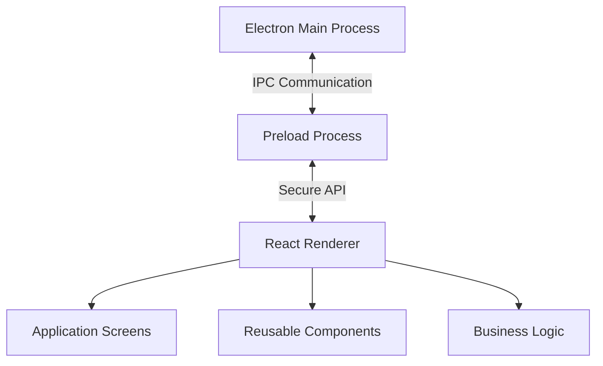

# CareConnect Electron Architecture

CareConnect can run either as the existing Vite web application or as an Electron desktop application.

## Processes

### Main process

Entry point: `electron/main.cjs`

The main process owns:

- Electron application lifecycle
- Single-instance enforcement
- Creation and restoration of the main `BrowserWindow`
- Native File, Edit, View, Window, and Help menus
- External-link handling
- Permission denial by default
- Production content security policy
- The allowlisted `desktop:get-app-info` IPC handler

The renderer never receives direct access to Node.js or Electron APIs.

### Preload process

Entry point: `electron/preload.cjs`

The preload script exposes a minimal `window.careConnectDesktop` API through `contextBridge`:

- `getAppInfo()` returns the desktop application name, version, and platform.
- `onNavigate(callback)` handles allowlisted navigation requests from the native application menu.
- `onShowShortcuts(callback)` opens the renderer's keyboard-shortcut guide.
- `onShowFileMenu(callback)` opens the keyboard-accessible renderer File menu when the native window receives `Alt+F`.

The preload script does not expose `ipcRenderer`, generic channel names, filesystem access, shell access, or arbitrary message payloads.

### Renderer process

Entry point: `src/main.tsx`

The renderer is the existing React application. It:

- Runs with `contextIsolation` enabled.
- Runs with Node integration disabled.
- Runs in Electron's sandbox.
- Uses the narrow preload API when available.
- Continues to work as a normal browser application when the preload API is absent.

Renderer API types are declared in `src/electron.d.ts`.

## Commands

### Development

The Vite development server must already be running:

```bash
pnpm desktop:dev
```

The main process uses `ELECTRON_RENDERER_URL` when provided. Otherwise, it connects to `http://127.0.0.1:$PORT`, defaulting to port `8443`.

### Production-style local run

Build the renderer with file-relative asset paths, then launch Electron:

```bash
pnpm desktop:build
pnpm desktop:start
```

The production-style main process loads `dist/index.html` directly.

## Security configuration

The `BrowserWindow` uses:

- `contextIsolation: true`
- `nodeIntegration: false`
- `sandbox: true`
- `webSecurity: true`
- A fixed local preload script
- Denied permission requests by default
- Denied popup creation
- External HTTP and HTTPS links opened through the operating system
- Sender validation for renderer-to-main IPC
- A restrictive production content security policy

Only development builds expose reload and developer-tools menu items.

## Architecture Diagram

The CareConnect Electron desktop application uses three main processes: Main, Preload, and Renderer. Each process has a different responsibility, and they work together to run the desktop application.



The **Main Process** controls the desktop window, application menus, and other Electron features.

The **Preload Process** allows the React application to communicate with Electron through a limited and secure API.

The **Renderer Process** displays the CareConnect screens and allows users to interact with the application.

Separating these processes helps us organize the application and limit direct access to Electron features.

## Code Structure

We organized the Electron application into different files and folders to make the code easier to understand, update, and test.

| File or Folder | Purpose |
|---|---|
| `electron/main.cjs` | Handles the Electron window, application menus, and desktop settings. |
| `electron/preload.cjs` | Allows communication between Electron and React. |
| `src/main.tsx` | Starts the React application. |
| `src/App.tsx` | Contains the main application component. |
| `src/screens/` | Contains the different CareConnect screens. |
| `src/components/` | Contains components that can be reused across screens. |
| `src/businessLogic.ts` | Contains functions used for application logic. |
| `src/types.ts` | Defines TypeScript types used in the application. |
| `src/electron.d.ts` | Defines the Electron API types used by React. |
| `src/ErrorBoundary.tsx` | Helps handle errors in the React application. |
| `src/App.test.tsx` | Contains tests for the application. |
| `src/businessLogic.test.ts` | Contains tests for the business logic. |
| `src/setupTests.ts` | Sets up the testing environment. |

## Why We Used This Structure

We used this structure to keep the application organized and make it easier to maintain.

Separating the screens and reusable components allows us to make changes without having to update the entire application.

Keeping the business logic in a separate file also makes it easier to test different functions.

We included automated tests to check that the application works as expected. We also used Electron's security settings to limit access between the desktop application and the React interface.

Overall, this structure helped us organize our work and support testing and future improvements.