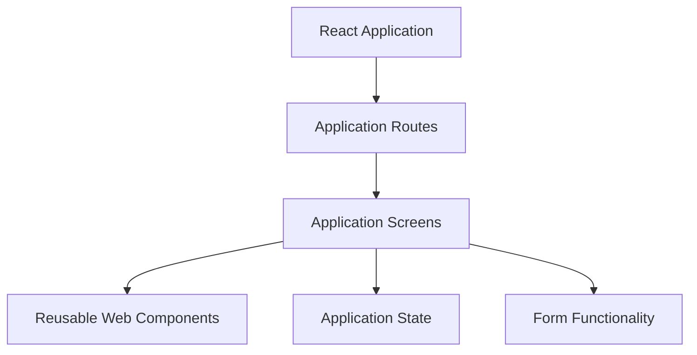

# CareConnect React Web Application

## Project Overview

CareConnect is a healthcare user interface designed with accessibility in mind, particularly for users with cerebral palsy and multiple sclerosis (MS).

Our team developed the React web application as part of the SWEN 661 project. The application includes screens for common healthcare activities such as appointments, medications, messages, and profile management.

The web application was built using React, TypeScript, Vite, and Tailwind CSS.

## Requirements

Before running the application, install:

- Node.js and npm
- Git
- A modern web browser

## How to Run the Application

1. Clone the CareConnect repository.
2. Open the `Week11-React-Web` folder in Terminal.
3. Install the dependencies:

```bash
npm install
```

4. Start the development server:

```bash
npm run dev
```

5. Open the local URL displayed in Terminal.

## Architecture Overview

The React web application is organized into screens, reusable components, routing, and application state.



This structure helps us keep the application organized and makes it easier to update individual screens and components.

## Code Structure

| File or Folder | Purpose |
|---|---|
| `src/main.tsx` | Starts the React application. |
| `src/app/App.tsx` | Contains the main application component. |
| `src/app/routes.tsx` | Defines application routing. |
| `src/app/screens.tsx` | Contains the application screens. |
| `src/app/components/WebUI.tsx` | Contains reusable web interface components. |
| `src/app/components/web-components.css` | Contains styling for the web components. |
| `src/app/store.tsx` | Manages application state. |
| `src/app/useForm.ts` | Contains form-related functionality. |
| `src/pwa.ts` | Contains PWA-related functionality. |
| `src/setupTests.ts` | Configures the Jest testing environment. |
| `src/app/*.test.tsx` | Contains automated application tests. |
| `e2e/` | Contains end-to-end tests. |

## Testing Instructions

We used Jest and React Testing Library to test the web application. We also used Playwright for end-to-end testing.

### Run Jest Tests

```bash
npm test -- --runInBand
```

### Generate Coverage Report

```bash
npm test -- --coverage --runInBand
```

The HTML coverage report is generated in the `coverage/` folder.

### Run Playwright Tests

```bash
npx playwright test
```

### Build Verification

```bash
npm run build
```

### Code Quality Check

```bash
npm run lint
```

## Previous Testing Results

During Week 11, our team recorded the following results:

| Metric | Result |
|---|---|
| Jest tests | 54 passed |
| Jest test suites | 17 passed |
| Statement coverage | 81.22% |
| Branch coverage | 84.66% |
| Function coverage | 72.51% |
| Line coverage | 81.35% |
| Playwright tests | 15 passed |

These results exceeded the 60% code coverage target. Final Week 12 results should be updated after integration and testing are complete.

## Accessibility

Accessibility is an important part of the CareConnect project because the application is intended to support users with different physical and accessibility needs.

For Week 12, our team will evaluate the web application using WAVE, axe DevTools, Lighthouse, keyboard navigation, and screen reader testing.

We will document the results, fix identified issues, and include accessibility testing evidence in our final submission.

## Production Build and Deployment

To create the production build, run:

```bash
npm run build
```

Vite generates the production files in the `dist/` folder.

To preview the production build locally:

```bash
npm run preview
```

The production files can be deployed to a hosting service that supports static web applications.

The final deployed URL will be added once the application is published and verified.

### PWA

The application includes PWA-related code in `src/pwa.ts`. The final submission requires verifying that the deployed web application can be installed as a PWA.

PWA installation should be tested on a supported browser after deployment.

## API Documentation

The current project structure includes application state management and form functionality. Any external API endpoints, if used, should be documented with their purpose, request details, and expected responses.

The presence of working backend API integration has not yet been verified.

## Known Issues and Limitations

This section will be updated after final accessibility and cross-browser testing.

Any remaining issues will be documented, including the affected feature, browser or platform, and possible impact on users.

## Repository

https://github.com/lnsoesie/CareConnect-Frontend

## Team Members

- Vindhya Sood
- Ashvini Tandale
- Lucrece Nsoesie